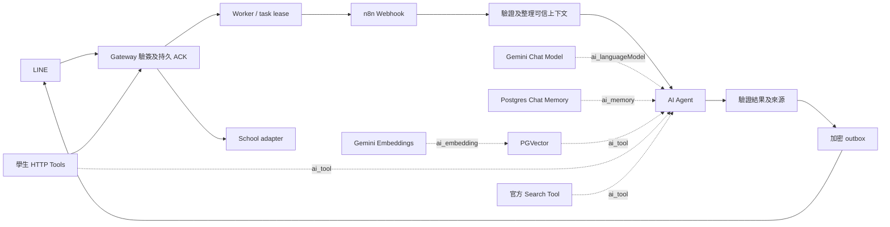

# 校園 n8n AI Agent 系統設計

更新：2026-10-13。部署操作見 [README](../README.md)，本輪部署驗收與歷史模型證據分列於 [Roadmap](ROADMAP.md)。目前採五服務 Compose；n8n owner 由容器內 supervisor 以必填 env 自動建立，Bot 工作流（credentials／workflows／Google credential）仍須手動設定，未完成遠端正式部署或完整真人驗收。

## 1. 目的與範圍

透過 LINE 提供國立臺中科技大學公開資訊問答及本人校務功能。核心為 n8n 原生 AI Agent、Google Gemini、Postgres Chat Memory、PGVector、Embeddings 與直接 HTTP Request Tools，不以 Call n8n Workflow Tool 統一包裝功能。

學校登入入口為 `https://sso.nutc.edu.tw/eportal/default.aspx`。既有校務程式參考 `nutc_student_system` 的 auth、schedule、absence、announcement service／parse，不沿用其密碼保存、自動重新登入或背景 warmup。校务 adapter 以本人 session 呼叫校方，不將既有程式 API 當作已部署的校方 API。

LINE Messaging Channel 為 `2011885580`，Login Channel 為 `2011885607`，LIFF 為 `2011885607-MccunYXG`；目前公開入口為 `https://nutc-agent.yuzen.dev/liff/`。後端驗證 LINE ID token 後建立本人 web session，不實作獨立 LINE Login callback。Login Channel 的 Published 狀態由使用者確認，不宣稱 Console 獨立驗證。

## 2. 系統責任與工作流

| 元件 | 責任 |
|---|---|
| gateway | private 3100 與 public 3101 同 process；LINE raw-body 驗簽、LIFF、任務、工具權限、搜尋委派、來源／render 驗證及 outbox 派送 |
| school-adapter | 校務登入、本地 OCR、Cookie 與本人校務查詢；內部 API 不對外公開 |
| n8n | 原生 Agent、工具選擇、對話記憶、公開語料匯入及檢索、直接 Google chat／embeddings／Search 呼叫 |
| PostgreSQL／pgvector | 獨立 n8n metadata DB 與 Agent DB；身分、任務、session、Memory、語料 |
| cloudflared／publicRouter | Tunnel 指向 gateway:3101；publicRouter 限制 host／path，不暴露 internal、provider 或 n8n 管理路徑 |

正式主流程 `campusNativeAgentLive` 與搜尋流程 `campusGoogleSearch` 由 `scripts/generate-live-agent-workflow.mjs` 產生；官方語料流程 `campusKnowledgeIngest` 由 `scripts/generate-knowledge-workflow.mjs` 產生。JSON 不含秘密；內部 credential 保存參照，Google 節點不放假 credential 參照，須由 owner 在 editor 建立及選取真 credential。生成不等於匯入、發布或驗收。owner 建立後手動執行 `bash scripts/setup-n8n.sh`，匯入三組內部 credentials 與三個 inactive 流程；任一目標 ID 已存在即拒絕，不覆寫使用者畫布。

主流程採 Webhook → prepare／整理訊息 → Agent → completion → 回覆。原生節點包含 Gemini Chat Model、Postgres Chat Memory、PGVector Store、Gemini Embeddings，以及 student_schedule、student_absence、student_announcements、student_grades、student_leave、student_send_mail 與 official_search。各工具固定端點及操作；模型只填允許的業務參數，不得提供使用者識別、任意 URL 或 capability。

正式流程不保存 n8n execution 原文。Agent maxIterations=5、timeout=90 秒，HTTP 工具每任務最多四次；此上限用於執行資源控制，不涵蓋所有原生工具。gateway worker 維持 5 並行；n8n production concurrency 為 10，提供 5 個 main 與 5 個 nested search 執行容量，避免所有 main 等待 queued child search。

## 3. 身分、任務與記憶

所有人可加入 LINE Bot；已驗簽的一對一事件或已驗證 LINE ID token 自動註冊本人身分，不需要受邀名單。群組不執行私人校務功能。首次並行請求由唯一鍵與身分 row lock 保護。

LINE 入口以 transaction 寫入 inbox／task 後快速 ACK，worker 隨 gateway 啟動並派送 n8n，不設額外啟用旗標；LINE ACK 不等待模型運算。prepare／tool／complete 綁定身分 generation、task、lease、capability 及一次 prepare 檢查點；capability 只存 hash。租約 90 秒、任務最長五分鐘，每人同時只處理一個任務。重複事件不再次呼叫 Agent。

session key 由後端驗證的身分與 generation 推導，不能由匿名輸入指定。Postgres Chat Memory contextWindowLength=5 只限制模型上下文，不自動限制資料庫筆數。正式記憶最多七天，支援清除對話與撤銷；資料庫 trigger 限制原生 Memory 只能寫有效 generation。

解除綁定或 unfollow 輪替 generation、刪除本人校務 session、私人暫存與記憶、取消未交付工作。follow 不能解除既有 revoked；本人精確傳送「重新啟用」只恢復助理，不恢復舊校務 Cookie。撤銷與派送共用身分鎖。migration 015 保留舊 `invited` 欄位，但不再以它控制准入。

## 4. 校務與個人資料

LIFF 登入由後端驗證 ID token，簽發 Secure／HttpOnly／SameSite=Lax session；敏感操作檢查 Origin 與 CSRF。一個學號只能綁一個 LINE 身分，同使用者／帳號禁止並行登入。

ASP.NET ViewState／captcha／CookieJar 協定由獨立 adapter 處理，本地 `ddddocr-node` 處理五字元驗證碼，最多三輪且總計 30 秒。只有明確 captcha 錯誤可重試；密碼錯誤、鎖定或結果不明立即停止。只有校方明確拒絕帳密才計入十五分鐘兩次保護；OCR、連線或解析失敗不計入。

密碼僅用於當次登入，不 trim、不保存。Cookie 留在後端加密保存；session 最長八小時、閒置三十分鐘。學校登入帳密不進模型。

2026-10-07 使用者明確核准本人校務結果提供 Google Gemini 整理。工具回傳經本人 session／task／lease／capability 驗證的結果及 ref；回答可保存於本人隔離 Memory，最多七天，不進共享 RAG。私人 ref 與待發 outbox 加密，completion 與派送再次核對本人 session 及撤銷狀態；LIFF 頁明示資料處理方式。未登入指引及獨立 Grounding 結果由後端固定產生，不被模型替換。

## 5. 公開語料與搜尋

原生生成模型為 `models/gemini-3.8-flash`，embedding 維持資料相容的 `models/gemini-embedding-001`／3072 維，不擅自更換。所有 Google keys／模型僅在 n8n 管理，gateway 不代理 Google 模型，根 `.env` 不設定 Google key／模型。owner 在 editor 建立 Google Gemini (PaLM) credential，使用官方 host `https://generativelanguage.googleapis.com`，為 main 的 Chat Model／Embeddings、ingest 的 Embeddings 及 search 的 HTTP Request 選取，保存並發布 main／search 後再手動 ingest。

官方語料初始網域為 `www.nutc.edu.tw`、`aca.nutc.edu.tw`、`student.nutc.edu.tw`、`elib.nutc.edu.tw`。管理者手動啟動匯入：固定官方 reader → hash 去重 → 原生 Gemini Embeddings → PGVector staging → 整批驗證／原子發布。只接受核定並取得原文的來源。

completion 核對本次 native observation 的來源版本、chunkId 與全文，绑定本次任務；完成及派送再次檢查來源有效性。記憶中的 sourceId 或僅存在的來源 ID 不能證明本次回答有依據。來源不足時拒答或追問。

Google 官方 Search Grounding 使用獨立的本人 LIFF 結果頁，呈現答案、來源及 Search Suggestions；主 Agent 只收到完成狀態。Grounding 不送 crawler、共享 RAG 或主 Agent Memory，不能冒充核定 RAG 原文。搜尋由 gateway 的 N8nGroundingProvider 以 webhook token 向同一 n8n origin 的 `/webhook/campus-google-search` POST `{query}`，不傳使用者權限或任意模型設定。`campusGoogleSearch` 採 header-auth webhook → 嚴格 query-only 驗證 → 原生 HTTP Request（固定 Google API URL、既有 model／prompt／google_search／tool／token 設定，使用 `googlePalmApi` credential）→ respond；錯誤分支固定安全回覆。gateway 仍保留 response schema／大小、來源及 render 安全驗證；搜尋委派不削弱本人 task／lease／capability／session 或 native observation 驗證。`GOOGLE_SEARCH_ENABLED=false`，啟用前需完成供應商與搜尋結果驗收。舊 Brave adapter 不作目前搜尋部署預設。

所有工具文字均視為資料，不能擴大權限或改寫系統指令。官方 reader 與校方 client 檢查固定 host、DNS 及 redirect；Docker 可連外並不等於供應商域名 allowlist。

## 6. 錯誤及訊息體驗

依使用者要求，應用程式不再實作費用預留、用量結算、每日／累計費用上限或任務 worker 啟用開關。模型、embedding 與搜尋費用由供應商計收；保留 token／body／response 大小、timeout、工具次數及任務期限限制。Google Search 獨立開關不變，模型不擅自更換。

技術錯誤、非法輸出或來源不符使用固定安全回覆，不曝露 stack、token、Cookie 或他人資料。worker 領取任務後 best-effort 呼叫 LINE loading API（60 秒、1.5 秒 request timeout），失敗不阻擋 Agent；動畫只支援正在查看一對一聊天室的手機，HTTP 202 不代表實際可見。

Agent 每次執行由 `$now.setZone('Asia/Taipei')` 注入日期、星期、時間及 UTC+08:00；今天／明天不依舊記憶或訓練日期。LINE push 統一轉純文字，保留 URL、程式碼與一般底線／乘號。

## 7. 部署與儲存

根 `docker-compose.yml` 是唯一入口，project name 為 `nutc-agent`，恰有 `postgres`、`n8n`、`gateway`、`school-adapter`、`cloudflared` 五個服務。`Dockerfile` 只有 `postgres`／`build`／`live` 三個 targets；backend 共用 live image。gateway 與 school-adapter 的啟動鏈先執行既有 checksum migration，再 exec server，沒有獨立 migrate service。

官方 n8n 2.41.7（固定 digest）依賴 PostgreSQL healthy；沒有 n8n-init 或第六服務，也不自動 import／publish。n8n service 以 `tini -- node /opt/campus/start-n8n.mjs` 為 entrypoint：supervisor 以官方 `/docker-entrypoint.sh` 啟動 n8n（子程序不含 `N8N_OWNER_*`），等 readiness 後讀 `/rest/settings`；`showSetupOnFirstLoad` 為 false（已有 owner）即略過，不登入、不比對、不修改；為 true 才以必填 `N8N_OWNER_EMAIL`／`N8N_OWNER_PASSWORD` 對 loopback 官方 `/rest/owner/setup` 單次 POST（密碼只在 body，不進 argv／log），並回讀 flag 為 false 才寫非秘密 ready marker。healthcheck 需 marker、readiness 與 flag=false 同時成立，gateway 因此在 owner 完成後才啟動。首次 POST 前先在持久 `n8n_data` 以原子 `wx` 建立非秘密 attempt marker（`/home/node/.n8n/.campus-owner-setup-attempt`，不含 email／密碼／payload）；flag 回讀 false 後才清除，成功路徑不留 marker。若 flag 仍 true 而 marker 已存在（Compose `restart: unless-stopped` 重啟、POST 結果未知），固定輸出 `N8N_OWNER_SETUP_REVIEW_REQUIRED` 並停止，不再 POST；若重啟時 flag 已 false（POST 已生效但回應遺失）則清除 stale marker 視為 existing。POST 失敗（非 2xx／timeout／network）亦保留 marker。人工調查：先備份 `n8n_data` 與 PostgreSQL，確認 owner 實際狀態；確認 owner 確實未建立後，由管理者在授權環境手動移除該 marker 檔再受控重啟重試，本專案不提供自動刪 marker 的啟動流程。失敗只輸出固定錯誤碼並終止 n8n，不盲目重試、不修 DB；SIGTERM／SIGINT 轉送子程序群組，45 秒 grace；直接子程序退出後以 process-group 存活檢查確認整組消失才結束，群組殘留者在原 grace deadline 後 SIGKILL，自然退出亦會有界清理殘留群組。owner 建立後再手動執行 `scripts/setup-n8n.sh`：Docker 內產生三組內部 credentials，經 stdin 使用官方 CLI 匯入 credentials 及三個 inactive workflows。任一目標 ID 已存在即拒絕；不使用舊 bootstrap state／pending，也不自動覆寫或復原。owner 選取 Google credential、發布 main／search，再手動 ingest。

根 `.env` 保留單一 `POSTGRES_PASSWORD`、64 hex `APP_MASTER_KEY`、`N8N_ENCRYPTION_KEY`、LINE／LIFF、公開 origin、Tunnel token 及搜尋開關；`N8N_OWNER_EMAIL`／`N8N_OWNER_PASSWORD` 必填且只傳給 n8n 容器（既有 owner 不被其覆寫）；`N8N_BASE_URL` 僅供 host 維護工具。三個 PostgreSQL role 共用密碼，n8n／Agent database 與 role 仍隔離；URL 由內部組合。master key 以 HKDF-SHA256 衍生用途隔離的 session、service、webhook、school-service、school-session、account-hash keys。Google key／模型僅由 n8n 管理。

既有資料先備份，不清空 volumes、不直接換 key 或覆寫 `.env`；改 project name 不會搬移 volumes，改環境變數不會 ALTER 舊 role 密碼。保留 `N8N_ENCRYPTION_KEY`，舊加密資料需受控遷移。migration 016 在 transaction 核對 fingerprint：既有身分無 marker 報 `EXISTING_DATA_REQUIRES_KEY_MIGRATION`，換 key 報 `APP_MASTER_KEY_CHANGED` 並 rollback。兩個 server 也在 repository／OCR／worker／listen 前只讀核對 marker，不可刪 marker 繞過。

Agent DB 保存身分、inbox／task／outbox、session、Memory、語料版本與 chunks。既有 SQL migration checksum 不改寫；歷史費用 schema 僅為資料相容保留，現行服務不讀寫。

兩個網路為 `backend`／`public`：PostgreSQL、n8n、school-adapter 只加入 backend，gateway 加入兩者，cloudflared 只加入 public。gateway 同一 process 監聽 private 3100 與 public 3101，publicRouter 限制 host／path。n8n 15680、gateway 3100 僅綁 host loopback，public 3101 與 school-adapter 無 host port。

官方 cloudflared 使用 `TUNNEL_TOKEN`，command 含 `--url http://gateway:3101` 與 `--metrics 0.0.0.0:20311`。沒有 remote ingress 時由固定 origin 提供入口；Dashboard 若設 remote ingress，也必須指向 `http://gateway:3101`，不可用 private 3100／localhost。hostname 對應 `PUBLIC_ORIGIN`；DNS／Tunnel 由管理者配置。`--wait` 只等待四個 healthchecks 與 cloudflared running，真 Cloudflare 連線須從 gateway 查 `http://cloudflared:20311/ready`。

秘密留在 `.env`／n8n credentials，不進 Git、build context 或 workflow JSON。自動啟動容器不是 Bot 配置完成；目前本機部署與公網入口驗證不代替完整真人、模型語意、負載、備份還原及遠端驗收。
